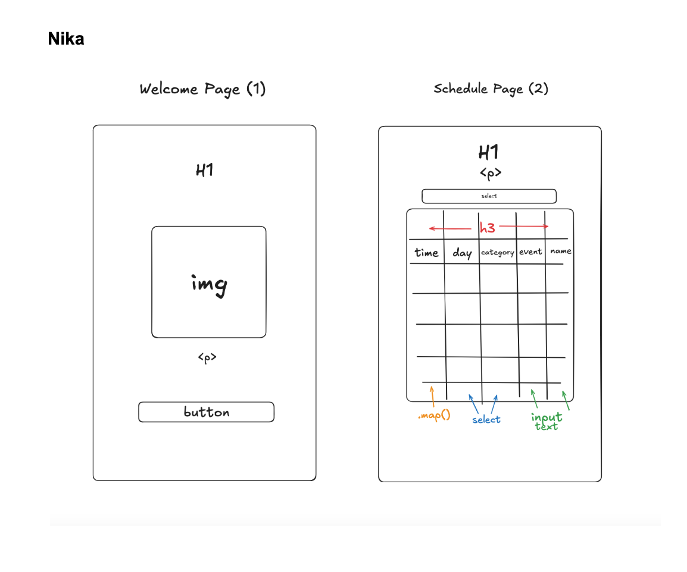

# Busy Mommie Planner

## App Description

A busy mom needs help organizing her daily schedule because she has many responsibilities, including managing her children's activities.

Busy Mommie Planner will help parents create a daily and weekly timeline to make family tasks easier to organize and accomplish.

## Persona

**Name and situation:** Jasmine is a busy mother managing her children's schedules and household responsibilities.

**Frustration:** She struggles to keep track of everyone's daily activities.

**Goal:** Organize family tasks by day, time, and family member.

**When she would use the app:** In the morning to plan her day and throughout the day to check scheduled tasks.

## In This Version

1. A visitor can view a list of family tasks organized by time and day of the week.
2. A visitor can add a task with a day, time, category, and name.
3. A visitor can delete tasks that are no longer needed.

## Left Out, and Why

1. **Notifications and reminders:** These are left out to keep the first version simple.
2. **User accounts and login:** Authentication would add complexity beyond the current project requirements.
3. **Photo uploads:** The first version will use a preset welcome image instead of allowing users to upload their own photos.

## Wireframe

The application will have two main pages:

### Welcome Page

- App title
- Welcome image
- Short introduction
- Button to open the planner

### Schedule Page

 - App title and family schedule heading
- Form to add new tasks
- Dropdown to select a day of the week
- 24-hour schedule from 12:00 AM to 11:00 PM
- Time, Category, Event, and Name columns
- Category colors to help organize tasks
- Delete buttons for scheduled tasks
- Home button to return to the Welcome Page

## Supabase Table Design

**Table name:** `weekly_daily_planner`

| Column | Type | Example Value |
|---|---|---|
| id | Automatically generated | 1 |
| times | text | 8:00 AM |
| days | text | Monday |
| category | text | School |
| task | text | Drop off |
| names | text | Mom |
| created_at | Automatically generated | Timestamp |

Supabase automatically creates the `id` and `created_at` columns.

## Three Example Rows

| Times | Days | Category | Task | Names |
|---|---|---|---|---|
| 8:00 AM | Monday | School | Drop off | Mom |
| 10:00 AM | Tuesday | Household | Laundry | Mom |
| 6:00 PM | Wednesday | Family | Homework | Child |

## System Explanation

**The visitor:** Selects a day, enters a time, category, task, and name, then clicks Add Task.

**The app:** Uses React components and state to manage the selected day and switch between the Welcome Page and Schedule Page.

The `useTable` hook retrieves data from the `weekly_daily_planner` table in Supabase.

The app uses `filter()` to find tasks that match the selected day and hour. It uses `map()` to display all 24 hours and the matching tasks in the schedule.

When a visitor adds a task, Supabase saves the new record and the app reloads the task list.

When a visitor deletes a task, Supabase removes the selected record using its unique ID.

**The visitor sees:** Their scheduled events displayed in the correct hourly rows, with category colors and assigned family members.

**While loading:** The app displays "Loading schedule..."

**If nothing matches:** The app displays "No tasks scheduled."

**If it fails:** The app displays "Unable to load or save tasks. Please try again."

## What Changed Since Week 7

Since Week 7, I completed the Add Task and Delete Task features using Supabase.

I redesigned the schedule to display all 24 hours of a selected day. I added a dropdown for choosing the day and another dropdown for selecting the task's time.

I used `filter()` and `map()` to organize the scheduled tasks and display them in the correct hourly rows.

I also added category colors, a welcome screen, a background image, and buttons to move between the Welcome Page and Schedule Page.

These changes made the application easier to use and helped me practice the React and JavaScript concepts I learned in class.

## Reflection

Busy Mommie Planner is designed for busy parents who need help organizing their daily family responsibilities.

The first version will allow visitors to view, add, and delete scheduled tasks.

I decided to leave out notifications, user accounts, and photo uploads to keep the project manageable with the skills I have learned.

The hardest feature to leave out was photo uploads because I originally wanted families to personalize their welcome page.

The main interaction is adding a task. A visitor enters the task information and clicks Add Task. The app saves the information in Supabase and displays the updated schedule.

## Technologies Used

- React
- Vite
- JavaScript
- Supabase
- CSS
- GitHub
- Netlify

## Team

We are a pod building our own apps.

### Pod Members

- Miaya Dennis — World Cultures
- Cindy Hulitsky — Dinosaurs
- Gbenga — Health Monitor
- Anastasia Ketchersid — Family Fun Planner
- Kevinika — Busy Mommie Planner

### Shared Pod Document

[Our Pod Capstone Plan]

(https://docs.google.com/document/d/1pAHUoA0O_Pil3cmCH792l70D3B6yPkERFIBjfPNTCwY/edit?tab=t.0)
